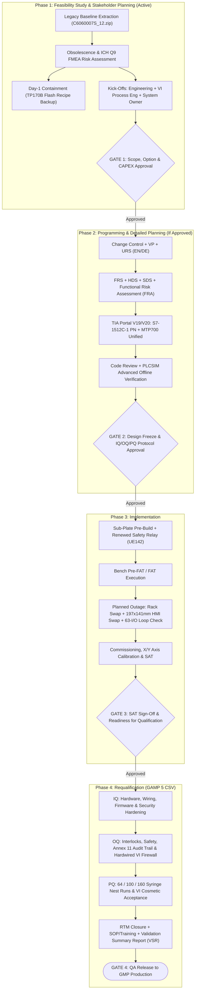

# 4-Phase ISPE GAMP 5 Master Project Roadmap — Syringe Nest Denester (`MP1P-Ferring`) Modernization

> [!IMPORTANT]
> **Project Scope**: Modernization of the legacy **CORIMA / IMA Life `MP1P-Ferring` Syringe Nest Denester** (`SIMATIC S7-300 CPU 313C` + `SIMATIC TP170B Color` `ProTool V6.0`) to **`SIMATIC S7-1500` (`CPU 1512C-1 PN`)** and **`SIMATIC HMI MTP700 Unified Comfort`** (`TIA Portal V19/V20`), governed under **ISPE GAMP 5 (Second Edition)**, **EU GMP Annex 11**, and **21 CFR Part 11** risk-based principles.

---

## Bilingual Executive Summary (`EN / DE`)

### English Summary
This project executes a structured **4-Phase GAMP 5 lifecycle** to eliminate critical obsolescence on the `MP1P-Ferring` syringe denester feeding the validated **Visual Inspection (VI)** line:
1. **Phase 1 — Feasibility Study & Stakeholder Planning *(Current Phase)***: Technical baseline audit of [`C6060007S_12.zip`](../00_Legacy_Baseline/PLC_HMI_Archive/C6060007S_12.zip), quantitative ICH Q9 / EN ISO 13849-1 risk assessment, Day-1 Flash recipe backup containment, and alignment workshops with **Engineering**, the **VI Process Engineer**, and the **System Owner** culminating in **Gate 1 Charter Approval**.
2. **Phase 2 — Programming & Detailed Planning *(Subject to Gate 1 Approval)***: Change Control initiation, GAMP 5 specifications (`VP`, `URS`, `FRS`, `HDS`, `SDS`, `FRA`, `RTM`), TIA Portal `S7-1500` & `WinCC Unified` software development, offline `PLCSIM Advanced` testing, and pre-approval of `IQ/OQ/PQ` protocols (**Gate 2**).
3. **Phase 3 — Implementation**: Pre-wired sub-plate assembly, bench `FAT`, mechanical drop-in swap (`MTP700 Unified` matches the legacy **`197 × 141 mm`** stainless cutout), 100% `63`-point I/O loop check, axis calibration, and `SAT` (**Gate 3**).
4. **Phase 4 — Requalification**: Formal `IQ`, `OQ`, and `PQ` execution (verifying the **Hardwired VI Validation Firewall** on `J291` / `B293` / `UE76` so the downstream VI system requires **zero re-qualification**), syringe cosmetic verification across `64 / 100 / 160` formats, `RTM` closure, SOP updates, and **Validation Summary Report (`VSR`)** release (**Gate 4**).

### Deutsche Zusammenfassung (Management-Übersicht)
Dieses Projekt folgt einem strukturierten **4-Phasen-Lebenszyklus gemäß ISPE GAMP 5 (2. Auflage)** zur Ablösung der abgekündigten Steuerung (`S7-300 CPU 313C` + `TP170B Color` `ProTool`) am Spritzen-Denester **`MP1P-Ferring`** vor der validierten **Visuellen Inspektion (VI)**:
1. **Phase 1 — Machbarkeitsstudie & Stakeholder-Planung *(Aktuelle Phase)***: Bestandsaufnahme aus [`C6060007S_12.zip`](../00_Legacy_Baseline/PLC_HMI_Archive/C6060007S_12.zip), quantitative FMEA-Risikobewertung, Sofortmaßnahmen zur Sicherung der nur im `TP170B`-Flash gespeicherten Achs-/Rezeptdaten (`DB20`/`DB21`/`DB106`) sowie Abstimmung mit **Engineering**, **VI-Prozessingenieur** und **System Owner** bis zur **Gate-1-Freigabe**.
2. **Phase 2 — Programmierung & Detailplanung *(nach Gate-1-Freigabe)***: Change-Control-Eröffnung, Erstellung der GAMP-5-Dokumente (`VP`, `URS`, `FRS`, `HDS`, `SDS`, `FRA`, `RTM`), TIA-Portal-Projektierung (`CPU 1512C-1 PN` + `MTP700 Unified Comfort`), Offline-Simulation und QA-Vorabfreigabe der Testprotokolle (**Gate 2**).
3. **Phase 3 — Implementierung**: Schaltschrank-Vormontage, Werkstest (`FAT`), mechanischer 1:1-Einbau ohne Edelstahlausschnitt (**`197 × 141 mm`** identisch), Loop-Check aller `63` E/A-Signale, Achskalibrierung und `SAT` (**Gate 3**).
4. **Phase 4 — Requalifizierung**: Durchführung von `IQ`, `OQ` und `PQ` unter Wahrung der **festverdrahteten 24-VDC-Schnittstelle zur VI-Linie** (`J291`, `B293`, `UE76` — **keine Revalidierung der VI-Maschine erforderlich**), Prüfung der Glasqualität für `64er / 100er / 160er` Nester, `RTM`-Abschluss und Freigabe über den **Validierungsabschlussbericht (`VSR`)** (**Gate 4**).

---

## 1. GAMP 5 V-Model & 4-Phase Gate Architecture

---

## 2. GAMP 5 System Classification & Regulatory Boundary

| Attribute | Classification / Determination | Rationale & Evidence from `C6060007S_12.zip` |
| :--- | :--- | :--- |
| **ISPE GAMP 5 Software Category** | **Category 4 (Configured Product)** with structured **Category 4/5** custom PLC sequence modules (`FB11`, `FB50`, `FC10`–`FC109`) | Standard `SIMATIC S7-1500` firmware, `High_Speed_Counter` TO, and `WinCC Unified` system controls (`Parameter Control`, `Alarm Control`, `Audit`), paired with migrated machine sequence logic (`31` blocks, `0` know-how protected). |
| **Equipment GxP Impact** | **Direct Impact (Mechanical Product Contact / Container Integrity)**; **No Electronic Batch Record Master Storage** | The denester extracts primary sterile/clean glass syringes from `64 / 100 / 160` nests onto VI conveyor `UE76`. Improper motion/force risks glass breakage or cosmetic defects, while batch Pass/Reject inspection records reside in the downstream **Visual Inspection (VI)** system. |
| **EU GMP Annex 11 / 21 CFR Part 11 Scope** | **Targeted Parameter & Security Controls (Annex 11 Cl. 7, 9, 12)** | Legacy `TP170B` uses shared numeric passwords, has zero audit trail, and exposes raw forcing screens (`FORZA_USCITE`). `MTP700 Unified` implements individual role-based logins (`Operator`, `Maintenance`, `VI Process Engineer`, `Admin`), automatic logoff, electronic parameter-change audit trail for `DB10`–`DB12` / `DB20`–`DB21` recipes, and Engineering-only lockouts on forcing functions. |
| **Downstream VI Validation Boundary** | **Hardwired 24VDC Firewall — Zero VI Re-Qualification** | Interface to the downstream VI system consists solely of `J291` (`I 125.0` VI Ready), `B293` (`I 125.2` Outfeed Max Level), and `UE76` (`Q 125.1` / `I 125.3` Connecting Belt VFD). Preserving identical 24VDC dry-contact timing avoids modifying hardware/software inside the validated VI boundary. |

---

## 3. Master Deliverable & Phase Gate Register

| Phase | Doc ID | Deliverable | Primary Owner | Reviewers / Approvers | Repository Location |
| :--- | :--- | :--- | :--- | :--- | :--- |
| **Phase 1** | `P1-INV-001` | Automated STEP 7 & ProTool Baseline Inventory + Sept 2026 `Denester_Fault` Audit | Automation Eng | Engineering | [`00_Legacy_Baseline/`](../00_Legacy_Baseline/) |
| **Phase 1** | `P1-FS-001` | Engineering Feasibility Study (Options `0–3`, BOM, Cutout, Schedule) | Engineering | System Owner, VI Process Eng | [`01_Engineering_Feasibility_Study.md`](../01_Phase1_Feasibility_Study/01_Engineering_Feasibility_Study.md) |
| **Phase 1** | `P1-RA-001` | Obsolescence & ICH Q9 FMEA Risk Assessment + Day-1 Containment | Automation Eng | Engineering, QA/CSV | [`02_Obsolescence_and_FMEA_Risk_Assessment.md`](../01_Phase1_Feasibility_Study/02_Obsolescence_and_FMEA_Risk_Assessment.md) |
| **Phase 1** | `P1-KO-001..3` | Stakeholder Kick-Off Packs (Engineering, VI Process Eng, System Owner) | Project Lead | All Stakeholders | [`03_Stakeholder_Kickoff_Packs/`](../01_Phase1_Feasibility_Study/03_Stakeholder_Kickoff_Packs/) |
| **Phase 1** | `P1-CL-001` | Shop-Floor Walkdown & Live `TP170B` Flash Recipe Capture Sheet | Maintenance / Eng | Automation Eng | [`04_Shopfloor_Walkdown_and_Backup_Checklist.md`](../01_Phase1_Feasibility_Study/04_Shopfloor_Walkdown_and_Backup_Checklist.md) |
| **Phase 2** | `P2-VP-001` | Change Control & GAMP 5 Validation Plan (`VP`) | System Owner / CSV | Engineering, QA | [`02_Phase2_Program_and_Planning/`](../02_Phase2_Program_and_Planning/README.md) |
| **Phase 2** | `P2-URS-001` | User Requirements Specification (`URS`) + VI Boundary Definition | System Owner + VI Eng | Engineering, QA | [`02_Phase2_Program_and_Planning/`](../02_Phase2_Program_and_Planning/README.md) |
| **Phase 2** | `P2-SPEC-001` | `FRS` + `HDS` + `SDS` + Functional Risk Assessment (`FRA`) + `RTM` | Automation Eng | VI Process Eng, CSV, QA | [`02_Phase2_Program_and_Planning/`](../02_Phase2_Program_and_Planning/README.md) |
| **Phase 2** | `P2-SW-001` | TIA Portal V19/V20 `S7-1512C-1 PN` & `MTP700 Unified` Project + Offline Sim Report | Automation Eng | Engineering | [`02_Phase2_Program_and_Planning/`](../02_Phase2_Program_and_Planning/README.md) |
| **Phase 3** | `P3-FAT-001` | Panel Sub-Plate Build, EPLAN Redlines, Bench `FAT` & Site `SAT` | Engineering / Integrator | System Owner, VI Eng | [`03_Phase3_Implementation/`](../03_Phase3_Implementation/README.md) |
| **Phase 4** | `P4-QUAL-001` | Executed `IQ`, `OQ`, `PQ` Protocols + Final `RTM` + SOPs + `VSR` | CSV / VI Process Eng | System Owner, QA | [`04_Phase4_Requalification/`](../04_Phase4_Requalification/README.md) |

---

## 4. Cross-Functional RACI Matrix

*(R = Responsible, A = Accountable, C = Consulted, I = Informed)*

| Activity / Gate | Engineering / Automation | VI Process Engineer | System Owner | QA / CSV |
| :--- | :---: | :---: | :---: | :---: |
| **Day-1 Containment (`TP170B` Flash Backup & Nameplates)** | **R** | I | **A** | I |
| **Phase 1 Feasibility, BOM & Option Selection (Gate 1)** | **R** | **C** | **A** | **C** |
| **Phase 2 `URS` & Syringe/VI Process Parameters** | C | **R** | **A** | **C** |
| **Phase 2 `VP`, Annex 11 Scope & Validation Boundary** | C | C | **R** | **A** |
| **Phase 2 TIA Portal Programming, `FRS/HDS/SDS` & Sim (Gate 2)** | **R / A** | C | C | **C** |
| **Phase 3 Hardware Retrofit, Loop Checks, `FAT` & `SAT` (Gate 3)** | **R** | **C** | **A** | I |
| **Phase 4 `IQ` & `OQ` Execution (incl. VI Firewall Test)** | **R** | C | C | **A** |
| **Phase 4 `PQ` Syringe Nest Runs (`64 / 100 / 160`)** | C | **R** | **A** | **C** |
| **Phase 4 `VSR` Approval & Release to GMP Production (Gate 4)** | C | C | **R** | **A** |

---

## 5. Preliminary Timeline (Post-Gate 1 Approval)

| Phase | Typical Duration | Line Downtime Required | Key Critical-Path Dependency |
| :--- | :--- | :--- | :--- |
| **Phase 1: Feasibility & Alignment** | Weeks `1–2` | **0 days** *(Walkdown during planned stop)* | Capturing live `TP170B` Flash parameters (`DB20/DB21/DB106`) & Gate 1 option choice. |
| **Phase 2: Program & Planning** | Weeks `3–8` *(Option 1)* / `3–11` *(Option 2)* | **0 days** | Hardware lead times (`CPU 1512C-1 PN`, `MTP700 Unified`), QA pre-approval of `IQ/OQ/PQ`. |
| **Phase 3: Implementation (`FAT` + Cutover + `SAT`)** | Weeks `9–11` | **2–3 days** *(Option 1)* / **5–7 days** *(Option 2 Servo)* | Scheduled VI line maintenance outage window. |
| **Phase 4: Requalification (`IQ / OQ / PQ` + `VSR`)** | Weeks `11–13` | **2–3 days** on-line qualification + `VSR` sign-off | Availability of `64`, `100`, and `160` qualification syringe nests & QA review turnaround. |
