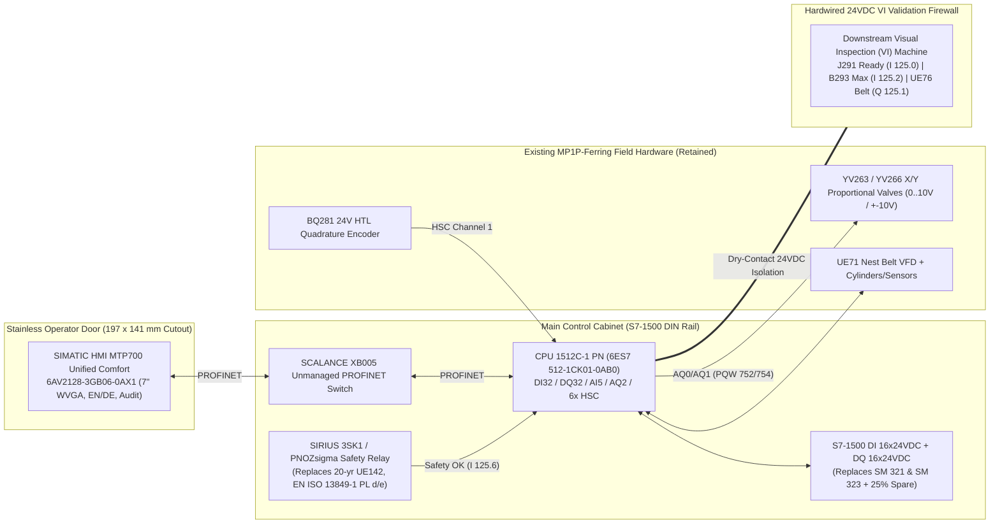

# Phase 1: Engineering Feasibility Study — `MP1P-Ferring` Syringe Nest Denester (`S7-300` & `ProTool` → `S7-1500` & `WinCC Unified`)

**Document ID**: `P1-FS-001` | **Lifecycle Framework**: ISPE GAMP 5 (2nd Ed.) — Phase 1 Feasibility | **Languages**: English & Deutsch (`EN / DE`)

---

## Executive Summary (`EN / DE`)

### English Executive Summary
The **CORIMA / IMA Life `MP1P-Ferring` Syringe Nest Denester** extracts glass syringes from `64`, `100`, and `160` nest formats and feeds them onto connecting conveyor `UE76` into the downstream **Visual Inspection (VI)** machine. Technical inspection of [`C6060007S_12.zip`](../00_Legacy_Baseline/PLC_HMI_Archive/C6060007S_12.zip) confirms **three urgent modernization drivers**:
1. **Total HMI Discontinuation & Unbacked Flash Recipes (`RPN = 125`)**: The `SIMATIC TP170B Color` (`6AV6 545-0BC15-2AX0`, `ProTool V6.0`) reached Total Discontinuation (`PM490`) on **2017-04-01**. Byte-level inspection proves that `DB20` (X-axis), `DB21` (Y-axis), and `DB106` (active gripper/discharge timers) are **all `0` in the offline STEP 7 project**—tuned production values exist only in the aging `TP170B` Flash/PLC RAM.
2. **S7-300 Discontinuation & Safety Mission Time (`RPN = 100 / 80`)**: The `SIMATIC S7-300` family (`CPU 313C V1.0`, `SM 321`, `SM 323`) entered **Type Discontinuation (`PM410`) on 2025-10-01**, and the ~2006 safety relay `UE142` has reached its **20-year EN ISO 13849-1 mission time ($T_M$)** in 2026.
3. **Recommended Target Architecture (`Option 1` Baseline)**: Migrate to **`SIMATIC S7-1500 CPU 1512C-1 PN`** (`6ES7 512-1CK01-0AB0`) + **`SIMATIC HMI MTP700 Unified Comfort`** (`6AV2128-3GB06-0AX1`) + renewed safety relay:
   - **Avoids the Classic Comfort Trap**: Classic `TP700 Comfort` entered Siemens `PM400` Phase-Out on **2026-01-31**; `MTP700 Unified Comfort` is the active long-term platform.
   - **Zero Stainless-Steel Cutting**: `MTP700 Unified Comfort` uses the exact **`197 × 141 mm`** panel cutout of the legacy `TP170B Color`.
   - **Zero Downstream VI Re-Qualification**: Preserves the **Hardwired 24VDC Validation Firewall** (`J291` at `I 125.0`, `B293` at `I 125.2`, `UE76` at `Q 125.1` / `I 125.3`).

### Deutsche Management-Zusammenfassung
Der **CORIMA / IMA Life `MP1P-Ferring` Spritzen-Denester** vereinzelt Glasspritzen aus `64er`, `100er` und `160er` Nestern auf das Verbindungsband `UE76` zur **Visuellen Inspektion (VI)**. Die Code-Analyse von [`C6060007S_12.zip`](../00_Legacy_Baseline/PLC_HMI_Archive/C6060007S_12.zip) belegt **drei kritische Handlungsfelder**:
1. **HMI-Totalabkündigung & Nullwerte im Offline-Projekt (`RPN = 125`)**: Das `TP170B Color` (`ProTool V6.0`) ist seit **01.04.2017 (`PM490`)** komplett abgekündigt. Im Offline-STEP-7-Projekt stehen alle Fahrgeschwindigkeiten, Rampen und Haltedrücke in `DB20` / `DB21` sowie Timer in `DB106` auf **`0`** – die realen Produktionswerte liegen ausschließlich im Flash-Speicher des Panels.
2. **S7-300-Abkündigung & EN ISO 13849-1 Gebrauchsdauer (`RPN = 100 / 80`)**: Die `S7-300`-Familie ist seit **01.10.2025 (`PM410`)** abgekündigt; das Sicherheitsrelais `UE142` (~2006) erreicht 2026 die maximale **20-jährige Gebrauchsdauer ($T_M$)**.
3. **Empfohlene Zielarchitektur (`Option 1`)**: Umrüstung auf **`CPU 1512C-1 PN`** + **`MTP700 Unified Comfort`** + neues Sicherheitsrelais. Der identische Schalttafelausschnitt (**`197 × 141 mm`**) vermeidet Blecharbeiten im Reinraum, und die Beibehaltung der **festverdrahteten 24-VDC-Kopplung** (`J291`, `B293`, `UE76`) schützt die nachgeschaltete VI-Linie vor einer Revalidierung.

---

## 1. Verified As-Is Technical Baseline (`MP1P-Ferring`)

All data below is automatically extracted by [`extract_s7_baseline.py`](../tools/extract_s7_baseline.py) into [`system_inventory.json`](../00_Legacy_Baseline/Extracted_Inventory/system_inventory.json) and [`field_devices_and_io.csv`](../00_Legacy_Baseline/Extracted_Inventory/field_devices_and_io.csv):

### 1.1 PLC Rack, HMI & Field Architecture
| Subsystem | Legacy Specification (Verified in `1.s7h` & `S7TDOP.DBF`) | Physical I/O & Signals | Key Finding |
| :--- | :--- | :--- | :--- |
| **Slot 2: Compact CPU** | `CPU 313C` (`6ES7 313-5BE00-0AB0`), FW `V1.0`, MPI `187.5 kbps` | `DI24/DO16` (`124..126`), `AI5/AO2` (`752..755`), `HSC` (`PID 768`) | `0` Ethernet ports; `PM410` discontinued; FW `V1.0` blocked from direct TIA V19/V20 hardware migration. |
| **Slot 4: Digital Input** | `SM 321 DI16xDC24V` (`6ES7 321-1BH01-0AA0`) | `I 0.0..1.7` (`14` active sensors incl. `B321..326`, `SQ324..338`) | `PM410` discontinued 2025-10-01. |
| **Slot 5: Digital I/O** | `SM 323 DI16/DO16x24V/0.5A` (`6ES7 323-1BL00-0AA0`) | `I 4.0..5.1`, `Q 4.0..4.3` (Extraction guide `SEQ3` `SQ341..352`, `YV361..364`) | `PM410` discontinued 2025-10-01. |
| **Operator Panel** | `SIMATIC TP170B Color` (`6AV6 545-0BC15-2AX0`), `ProTool V6.0` (`C6060007H_10`) | `37` screens (`IT / DE`), MPI address `1`, `197 × 141 mm` cutout | `PM490` discontinued 2017-04-01; incompatible with direct TIA Portal V19/V20 import. |
| **X/Y Transfer Axes** | Pneumatic proportional valves `YV263` (`PQW 752`) & `YV266` (`PQW 754`) | Controlled by `FB11` (`MOV_ASSE`) + `FC51` (`SCALING_I2W`) + `SQ331..338` | Open-loop analog velocity/pressure profiles (`DB20`/`DB21`) tuned via discrete reed switches. |
| **Nest Indexing** | `BQ281` 24V HTL quadrature encoder + `UE71` VFD | `I 124.0..124.3`, `PID 768` (`SFB 47 COUNT`), `Q 124.6` / `I 125.5` | Indexes syringe rows per recipe pitch tables `DB12` (`64`), `DB10` (`100`), and `DB11` (`160`). |
| **VI Line Interface** | Hardwired 24VDC dry-contact interlocks + `UE76` VFD | `J291` (`I 125.0`), `B293` (`I 125.2`), `UE76` (`Q 125.1` / `I 125.3`) | Clean physical validation boundary to downstream Visual Inspection machine. |

### 1.2 Software Transparency & `Denester_Fault` Sept 2026 Audit
- **`31` PLC Blocks (`0` Know-How Protected)**: `OB1`, `OB100`, `FB11` (`MOV_ASSE`), `FB50` (`CALCOLO_PASSO`), `FC10` (`SEQUENCER`), `FC11` (`MOV_PISTONE`), `FC40` (`SYS_TP170_M6`), `FC51` (`SCALING_I2W`), `FC99` (`MOT_NEST`), `FC100` (`STATI`), `FC101` (`CONTAPEZZI`), `FC102` (`PISTONI`), `FC103` (`SICUREZZA`), `FC104` (`LAMPADA_COLONNA`), `FC105` (`MASTER_RESET`), `FC106` (`SEQ1_SOL_SIRINGHE`), `FC107` (`SEQ2_TRA_SIRINGHE`), `FC108` (`SCA_SIRINGHE`), `FC109` (`SEQ3_GUIDA_SIRINGHE`), `DB10..12`, `DB20..21`, `DB90`, `DB100`, `DB105`, `DB106`, plus system blocks `SFC0`, `SFC1`, `SFB47`.
- **100% Verified Logic Integrity**: Checksum comparison against `ombstx/offline_ORIGINAL_BACKUP/` (`2016-03-17`) proves **`0` bytes of MC7 code were modified** during the September 2026 `Denester_Fault` investigation; all `362` symbols were cleanly translated into `EN / DE` ([`sept2026_denester_fault_diff.csv`](../00_Legacy_Baseline/Denester_Fault/sept2026_denester_fault_diff.csv)).
- **Syringe Nest Pitch Recipes (Saved Offline)**:
  - **`DB12` (`64`-Syringe Nest, `8` rows)**: `[150, 275, 400, 525, 650, 775, 900, 1025]`
  - **`DB10` (`100`-Syringe Nest, `10` rows)**: `[29, 128, 229, 320, 419, 518, 617, 716, 815, 914]`
  - **`DB11` (`160`-Syringe Nest, `16` rows)**: `[648, 725, 802, 879, 950, 1033, 1104, 1181, 1258, 1335, 1406, 49, 120, 197, 274, 351]`

---

## 2. Why Direct "1-Click TIA Portal Migration" Is Blocked (Technical Proof)

1. **`ProTool V6.0` (`PRO.PDB`) Discontinued Pipeline**: TIA Portal V19/V20 cannot open `.PDB` files. Historically, Siemens required a 3-hop chain (`ProTool V6.0` → `WinCC flexible 2008 SP2/SP3` on WinXP/Win7 → `TIA Portal V13/V14` Comfort → `WinCC Unified` via Data2Unified). Rebuilding the `37` compact QVGA (`320 × 240`) screens natively in **WinCC Unified (`800 × 480` WVGA)** using modern `Parameter Control`, `Alarm Control`, and `Audit` objects is cleaner, faster to validate under GAMP 5, and eliminates legacy MPI area-pointer workarounds (`FC40 SYS_TP170_M6`).
2. **`CPU 313C` Firmware `V1.0` & `SFB 47 COUNT`**: TIA Portal's built-in hardware migration rejects pre-2004 `6ES7 313-5BE00-0AB0` (`V1.0`) CPUs and S7-300-specific `SFB 47` (`COUNT`) integrated peripheral channels (`PID 768`). On `CPU 1512C-1 PN`, `SFB 47` maps cleanly to the standard **`High_Speed_Counter` Technology Object** while all `19` application `OB/FB/FC` blocks convert cleanly via STL/LAD source migration.

---

## 3. Multi-Criteria Comparison of 4 Strategic Options

| Criterion | **Option 0: Status Quo (Run-to-Failure)** | **Option 1 (Recommended): Controls & Safety Retrofit** | **Option 2: Controls + Electric Servo X/Y Upgrade** | **Option 3: Full New OEM Denester Machine** |
| :--- | :--- | :--- | :--- | :--- |
| **Technical Scope** | Do nothing; rely on gray-market spares | `CPU 1512C-1 PN` + `MTP700 Unified` + renewed `UE142` safety relay + optional VFD refresh; keep pneumatic X/Y (`YV263`/`YV266`) | Option 1 + replace pneumatic X/Y cylinders/valves (`YV263`/`YV266`) with 2x `SINAMICS S210` electric servo axes | Replace entire `MP1P-Ferring` denester + conveyor integration |
| **ROM CAPEX Band (EUR)** | **€0 upfront** *(€80k–€250k+ unscheduled VI line outage exposure)* | **€28k – €42k** *(Hardware ~€7k–€10k + Eng/Build/CSV)* | **€58k – €85k** *(Adds servo mechanics, S210 drives, CE safety re-assessment)* | **€220k – €350k+** |
| **Planned VI Line Outage** | `0` days planned *(Weeks unplanned on failure)* | **2 – 3 days** *(Drop-in `197 × 141 mm` HMI cutout)* | **5 – 7 days** *(Mechanical gantry rework + tuning)* | **3 – 5 weeks** *(Rigging, utilities, line layout)* |
| **Delivery Lead Time** | N/A | **10 – 13 weeks** end-to-end (Phases 1–4) | **16 – 22 weeks** | **36 – 52+ weeks** |
| **Syringe Glass / Process Impact** | Degrades with proportional valve drift | Equivalent to baseline; adds drift diagnostics & locked recipes *(recommended if current cosmetic yield is acceptable)* | **Highest motion repeatability**; eliminates pneumatic zero drift (`TARATURA ASSE X/Y`) & air fluctuation sensitivity | New container-handling qualification required |
| **Downstream VI Validation Impact** | None until failure | **Zero VI Re-Qualification** (Hardwired `J291`/`B293`/`UE76` preserved) | **Zero VI Re-Qualification** (Hardwired VI firewall preserved; expanded Denester OQ/PQ + CE Machinery assessment) | **Full Line PQ** & physical conveyor interface re-qualification |
| **GAMP 5 / Annex 11 Compliance** | **Non-compliant** (Shared passwords, no audit trail, raw forcing) | **Compliant** (RBAC, Parameter Audit Trail, locked forcing) | **Compliant** (RBAC, Parameter Audit Trail, closed-loop servo recipes) | **Compliant** |

> [!TIP]
> **Engineering Recommendation for Gate 1**: Approve **Option 1** as the baseline modernization path **unless** the **VI Process Engineer** confirms recurring glass syringe cosmetic rejects or frequent manual `TARATURA ASSE X/Y` re-tuning caused by pneumatic proportional valves `YV263`/`YV266`, in which case **Option 2** provides a permanent closed-loop mechanical cure.

---

## 4. Target Hardware Architecture & Preliminary BOM (`Option 1` Baseline)

### Preliminary Hardware Bill of Materials (`Option 1`)
| Item | Qty | Siemens / Industrial Part Number | Description & Sizing Rationale |
| :--- | :---: | :--- | :--- |
| **1** | 1 | `6ES7 512-1CK01-0AB0` | **SIMATIC S7-1500 CPU 1512C-1 PN** (`DI32`, `DQ32`, `AI5`, `AQ2`, `6x HSC` up to 100 kHz, dual PROFINET) + `40 mm` front connectors |
| **2** | 1 | `6ES7 954-8LF03-0AA0` | **SIMATIC Memory Card, 24 MB** (Retentive project, recipe & diagnostic storage) |
| **3** | 1 | `6ES7 521-1BH00-0AB0` | **S7-1500 SM DI 16x24VDC HF** + front connector (Provides `48` total DI vs. `40` legacy active DI = **20% spare**) |
| **4** | 1 | `6ES7 522-1BH01-0AB0` | **S7-1500 SM DQ 16x24VDC/0.5A ST** + front connector (Provides `48` total DQ vs. `20` legacy active DQ = **>100% spare**) |
| **5** | 1 | `6AV2 128-3GB06-0AX1` | **SIMATIC HMI MTP700 Unified Comfort**, 7" widescreen touch, **exact `197 × 141 mm` mounting cutout** matching legacy `TP170B Color` |
| **6** | 1 | `6AV2 157-1CA00-0AB0` *(if Annex 11 Audit selected)* | **WinCC Unified Audit Basis RT License** (Electronic parameter-change audit trail & tamper-evident export) |
| **7** | 1 | `3SK1111-1AB30` *(or Pilz `PNOZ s4`)* | **Dual-Channel Safety Relay (24VDC)** replacing 20-year-old `UE142` (`EN ISO 13849-1 PL e / SIL 3`) |
| **8** | 1 | `6GK5 005-0BA00-1AB2` + `6EP3 333-8SB00-0AY0` | **SCALANCE XB005** 5-port PROFINET switch + **SITOP PSU6200 24VDC / 5A** stabilized power supply + `S7-1500` DIN mounting rail |

> [!WARNING]
> **Critical Pre-Procurement Verification (`Walkdown Item W-3`)**: Verify electrical signal type (`0–10 V`, `±10 V`, or `4–20 mA`) of proportional valves `YV263` and `YV266` on the cabinet schematics / multimeter during the Phase 1 walkdown. `CPU 1512C-1 PN` integrated analog outputs support both voltage (`±10 V`, `0–10 V`) and current (`0/4–20 mA`) directly in TIA Portal hardware configuration.
